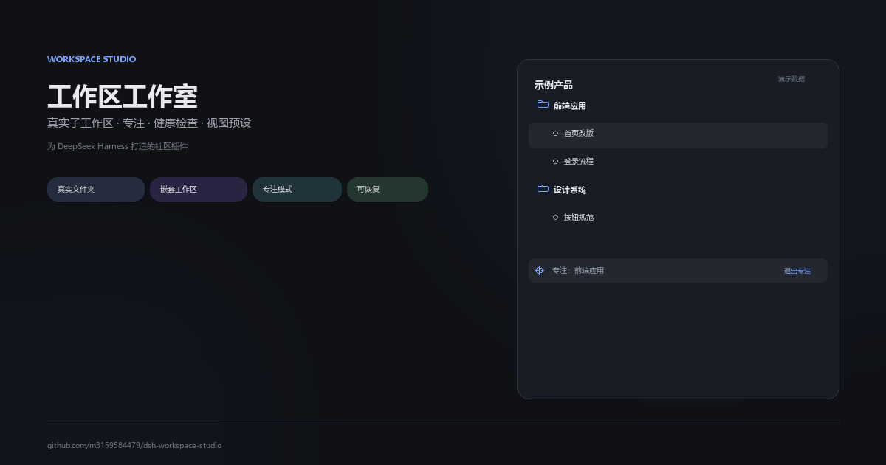
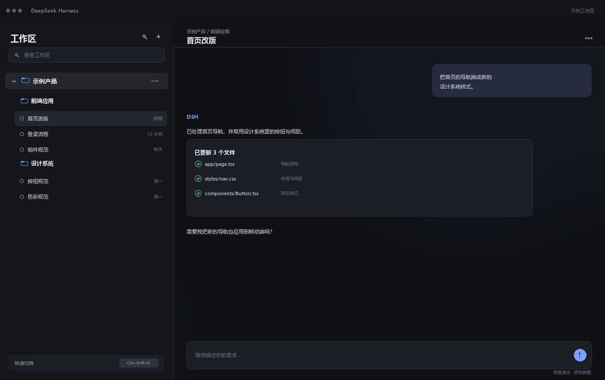
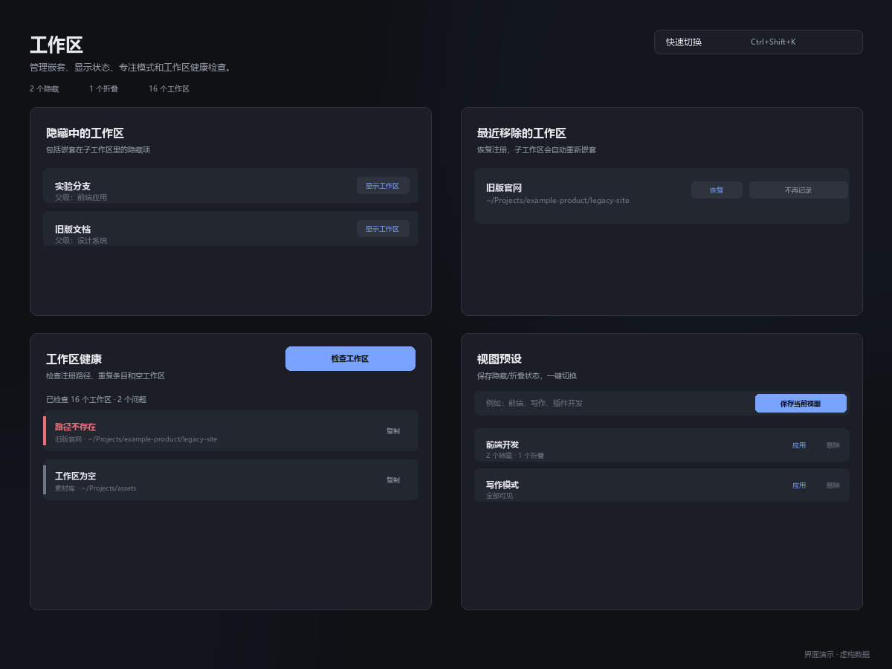

# Workspace Studio · 工作区工作室

> 为 DeepSeek Harness 提供**真实嵌套工作区**、隐藏/折叠、专注模式、健康检查和视图预设的社区插件。
>
> 这是一个独立社区项目，不是 DeepSeek 官方仓库，也不代表官方立场。



## 它解决什么问题

DSH 自带工作区列表，但当项目变多以后，容易出现这些问题：

- 工作区一层套一层，侧边栏越来越长；
- 子工作区只能靠名字猜层级；
- 想专注一个项目时，其他工作区还在干扰；
- 误删工作区注册后，不知道里面的子工作区还在不在；
- 工作区路径失效、重复、嵌套太深，但没有地方检查。

Workspace Studio 把这些问题集中到工作区的「…」菜单和一个「工作区」管理页里。

## 界面演示

> 以下截图全部使用**虚构项目数据**（示例产品、前端应用、设计系统等），仅用于展示界面效果，不包含任何真实项目、路径或会话内容。

### 工作区树 + 对话



- 父工作区和子工作区按真实文件夹路径嵌套；
- 会话行归属于对应的工作区；
- 选中会话有轻量背景，不抢对话内容的注意力；
- 右下角提示快速切换快捷键。

### 工作区「…」菜单


菜单按组整理：

```text
新建子工作区
────────────
专注 / 退出专注
折叠 / 展开
隐藏子工作区 / 显示子工作区
────────────
隐藏此工作区
删除工作区
```

- 创建、视图、破坏性操作分成三组；
- 折叠和隐藏子工作区使用不同图标，不再混淆；
- 「隐藏此工作区」和「隐藏子工作区」是两种不同作用域。

### 工作区管理页



Settings → Plugins → 工作区：

- **隐藏中的工作区**：列出所有显式隐藏的工作区，包括嵌套在子工作区里的；显示时会恢复父级链、展开折叠并清除专注。
- **最近移除的工作区**：恢复误删的注册；子工作区会按路径自动重新嵌套。
- **工作区健康**：检查路径不存在、不是文件夹、符号链接、重复路径、空工作区和嵌套过深。
- **视图预设**：保存当前的隐藏/折叠状态，一键切换。

## 功能

- **真实子工作区**：在父工作区里创建真实文件夹，并注册为子工作区；不是虚拟分组。
- **Workspace Tree 自动嵌套**：继续使用 DSH 原生的「按工作区树」视图，按磁盘路径显示层级。
- **折叠 / 隐藏**：
  - 折叠：收起会话和子工作区，父工作区行保留；
  - 隐藏：整个工作区行消失；子工作区隐藏不会跑到侧边栏外面。
- **专注模式**：只显示目标工作区、父级链和子级链；顶部专注条一键退出。
- **快速切换**：`Ctrl+Shift+K` 搜索工作区、路径和会话，回车打开。
- **工作区健康检查**：Host 侧只读检查，发现问题不会自动删除任何东西。
- **视图预设**：保存隐藏/折叠组合，适合「前端」「写作」「插件开发」等不同工作模式。
- **最近移除 / 恢复**：本地快照记录被移除的注册；恢复父级时保留并重新嵌套子工作区。
- **真实文件夹删除**：仅对子工作区开放，二次确认后永久删除；父级工作区保留原生「删除工作区」行为（只移除注册，不删文件）。
- **插件对话**：Settings → Plugins 里的「插件对话」页，用于非官方插件的修复对话。

## 安装

从 GitHub 安装：

```sh
dsh plugin --profile desktop add github:m3159584479/dsh-workspace-studio
```

或者克隆后安装本地目录：

```sh
git clone https://github.com/m3159584479/dsh-workspace-studio.git
dsh plugin --profile desktop add ./dsh-workspace-studio
```

要求：

- DeepSeek Harness `>=0.2.1-rc.2`
- 工作区文件夹对 Harness 进程可写
- 仅支持本地文件系统，不支持远程/SSH 工作区路径

## 使用

1. 打开工作区行的「…」菜单。
2. 选择「新建子工作区」，输入文件夹名并确认。
3. 在「视图选项 → 分组 → 按工作区树」查看层级。
4. 用「专注」只看一个分支，用「折叠」收起会话和子级。
5. 用 `Ctrl+Shift+K` 快速跳转工作区或会话。
6. 到 **Settings → Plugins → 工作区** 管理隐藏项、恢复误删、跑健康检查和保存视图预设。

## 安全边界

- **真实删除不可撤销**：只对子工作区开放，且会拒绝包含其他注册工作区、符号链接或非目录的路径。
- **普通文件夹不会被自动收养**：新建子工作区只创建新文件夹；已存在的文件夹会返回 `409 exists`。
- **原生「添加工作区」** 仍然可以把普通子文件夹注册成工作区；这是 DSH 原生行为，插件不会拦截。
- **移除历史从本版本开始记录**：更早删除的工作区可能没有历史记录，可直接用原生「添加工作区」把父文件夹加回来。
- **Host 路由仅本地使用**：创建/删除/恢复/健康检查都要求本地请求头，但仍是本地 HTTP 路由，安装前请阅读源码。
- **不是官方插件**：本项目为社区维护，未经过 DeepSeek 官方审核。

## 开发

```text
client.js        Client UI、工作区菜单、隐藏/折叠/专注、快速切换、管理页
index.js         Host 路由：创建、删除、恢复、健康检查
cordis.patch.yml Loader patch
locale/          插件管理页的中英文显示信息
icon.svg         插件图标
docs/            界面演示图片
```

语法检查：

```sh
node --check client.js
node --check index.js
```

## License

MIT。见 [LICENSE](./LICENSE)。

---

**English summary:** Workspace Studio is a community plugin for DeepSeek Harness that adds real nested workspaces, collapse/hide and focus modes, quick switching, view presets, workspace health checks, and restoration of removed workspace registrations. It is not an official DeepSeek project.
