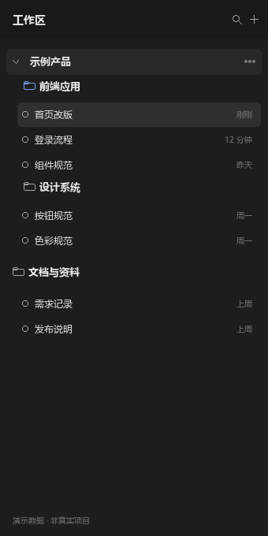
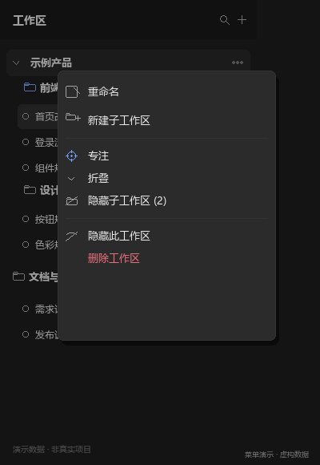

# Workspace Studio · 工作区工作室

> 为 DeepSeek Harness 提供真实嵌套工作区、隐藏/折叠、专注模式、健康检查和视图预设。
>
> 社区插件，不是 DeepSeek 官方仓库。

> 下面的截图使用**虚构项目数据**，只演示界面效果，不包含任何真实项目、路径或会话。

## 工作区树



父工作区和子工作区按真实文件夹路径嵌套；会话行跟随所属工作区。

## 工作区菜单



菜单分成三组：

- 新建、重命名
- 专注 / 折叠 / 隐藏子工作区
- 隐藏此工作区 / 删除工作区

## 功能

- **真实子工作区**：创建真实文件夹并注册为子工作区，不是虚拟分组。
- **Workspace Tree**：使用 DSH 原生的「按工作区树」视图显示层级。
- **折叠 / 隐藏**：折叠保留父行；隐藏子工作区只在父级内部生效。
- **专注模式**：只显示一个工作区及其父/子链，顶部专注条退出。
- **快速切换**：`Ctrl+Shift+K` 搜索工作区、路径和会话。
- **工作区健康**：检查路径不存在、重复注册、空工作区、符号链接和嵌套过深。
- **视图预设**：保存隐藏/折叠组合，一键切换。
- **最近移除 / 恢复**：恢复误删的注册；父级恢复后子工作区按路径重新嵌套。
- **真实文件夹删除**：仅子工作区可用，二次确认后永久删除；父级保留原生删除注册行为。

## 安装

```sh
dsh plugin --profile desktop add github:m3159584479/dsh-workspace-studio
```

或：

```sh
git clone https://github.com/m3159584479/dsh-workspace-studio.git
dsh plugin --profile desktop add ./dsh-workspace-studio
```

要求 DSH `>=0.2.1-rc.2`，仅支持本地文件系统。

## 使用

1. 工作区「…」→「新建子工作区」。
2. 在「视图选项 → 分组 → 按工作区树」查看层级。
3. 用「专注」只看一个分支，用「折叠」收起会话和子级。
4. `Ctrl+Shift+K` 快速跳转。
5. **Settings → Plugins → 工作区** 里管理隐藏、恢复、健康检查和视图预设。

## 安全边界

- 真实文件夹删除不可撤销，只对子工作区开放。
- 新建子工作区只创建新文件夹；已有文件夹返回 `409 exists`，不会自动收养。
- 原生「添加工作区」仍可把普通子文件夹注册成工作区，这是 DSH 原生行为。
- 移除历史从本版本开始记录；更早的删除可能没有记录。
- Host 路由仅本地使用，但仍是本地 HTTP 路由，安装前请阅读源码。

## 开发

```text
client.js        Client UI
index.js         Host 路由
cordis.patch.yml Loader patch
locale/          中英文显示信息
icon.svg         插件图标
docs/            演示图片
```

## License

MIT。见 [LICENSE](./LICENSE)。

---

**English:** Community plugin for DeepSeek Harness adding real nested workspaces, hide/collapse and focus modes, quick switch, health checks, view presets, and removed-workspace recovery. Not an official DeepSeek project.
