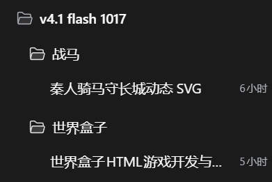
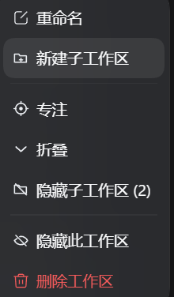

# Workspace Studio

**为 DeepSeek Harness 提供嵌套工作区管理与对话式插件维护的社区插件。**

Workspace Studio 在 DSH 原生工作区能力之上，补充真实子工作区、层级导航、专注模式、工作区健康检查、视图预设，以及针对非官方插件的对话式调整入口。

> 本项目为独立社区项目，并非 DeepSeek 官方仓库，也不代表官方立场。
>
> 当前版本：`v1.2.5` · 许可证：MIT · DSH：`>=0.2.1-rc.2`

## 界面

<p align="center">
  
  
</p>

左：真实嵌套的工作区树。右：工作区「…」菜单。

## 核心能力

### 首次安装教程

第一次加载插件时，会启动**交互式引导**：高亮框会直接指向当前界面里的真实控件，并沿着真实路径一步步推进，而不是只显示一张说明卡片。

1. 高亮工作区行，提示点击右侧的 `…` 打开菜单。
2. 菜单打开后，高亮「新建子工作区」并说明它会创建真实文件夹。
3. 创建对话框打开后，高亮文件夹名输入框，并说明已有文件夹会被拒绝、子工作区删除不可撤销。
4. 高亮侧边栏底部的**设置**入口。
5. 设置打开后，高亮**插件**。
6. 插件页打开后，高亮**插件对话**标签。
7. 高亮插件行上的**对话**按钮，说明如何用对话调整插件。

第 4–7 步会在提示框里显示路径条：**设置 › 插件 › 插件对话 › 对话**，当前步骤高亮。引导会自动跟随菜单、对话框和设置页推进，不会遮住要点击的控件；可以随时跳过。关闭或跳过后记住状态，之后可以从 **Settings → Plugins → 工作区 → 使用教程** 重新打开。教程不会修改工作区或插件。

> 升级后如果教程没有自动出现，通常是当前浏览器已经记录过旧版教程。直接点「使用教程」即可；v1.2.2 使用新的引导记录键。

### 真实嵌套工作区

- 在任意工作区内创建真实文件夹，并注册为子工作区。
- 继续使用 DSH 原生的 **Workspace Tree** 视图，按真实磁盘路径显示层级。
- 新建操作只创建新目录；已存在的目录不会被自动接管或注册。

### 折叠、隐藏与专注

- **折叠**：收起当前工作区的会话和子工作区，保留工作区行。
- **显示/隐藏子工作区**：菜单打开勾选列表，逐个选择要显示的子级；不会一键全部显示或隐藏。
- **隐藏此工作区**：将整个工作区移出侧边栏。
- **专注**：只显示目标工作区及其父级链、子级链，适合多项目并行时隔离上下文。
- 隐藏状态、折叠状态和专注状态均可持久化。

### 导航与工作区管理

- **快速切换**：`Ctrl+Shift+K` 搜索工作区、路径和会话。
- **视图预设**：保存隐藏/折叠组合，在「前端开发」「写作」等工作模式之间切换。
- **工作区健康检查**：检查路径不存在、重复注册、非目录、符号链接、空工作区和嵌套过深。
- **最近移除 / 恢复**：记录被移除的工作区注册；恢复父级后，子工作区按路径重新嵌套。
- **隐藏项管理**：集中查看所有显式隐藏的工作区，包括嵌套在子工作区中的条目。

### 对话式插件调整

DSH 的插件通常通过配置、源码和补丁组合而成。直接在插件页里找文件、核对包名和版本并不直观。Workspace Studio 在 **Settings → Plugins** 中提供「插件对话」入口：

1. 选择要调整的**非官方插件**，或该插件下的某一行。
2. 可填写本次调整说明。
3. 点击「对话」。

插件会新建或复用一条带上下文的会话，内容包括：

- 插件包名、安装状态和启用状态；
- 对应 bundle 或 plugin row 的身份；
- 可选的调整说明；
- 插件来源、版本和修改前的核对步骤；
- 会话标记，用于下次回到同一条对话。

已有对话会直接复用；按住 `Shift` 点击「对话」可强制新建。这个功能的定位是**把插件问题带进一条有上下文的修复/调整会话**，不会在后台自动修改代码或安装插件；实际改动仍由会话中的 Agent 与你确认。

### 真实文件夹删除

- 仅子工作区提供「删除工作区文件夹」操作。
- 删除前需要二次确认。
- 拒绝删除包含其他注册工作区、符号链接或非目录的路径。
- 顶层工作区保留 DSH 原生的「删除工作区」行为：只移除注册，不删除文件。

## 安装

从 GitHub 安装：

```sh
dsh plugin --profile desktop add github:m3159584479/dsh-workspace-studio
```

或者克隆后安装本地目录：

```sh
git clone https://github.com/m3159584479/dsh-workspace-studio.git
dsh plugin --profile desktop add ./dsh-workspace-studio
```

环境要求：

- DeepSeek Harness `>=0.2.1-rc.2`
- 工作区目录对 Harness 进程可写
- 仅支持本地文件系统；远程/SSH 路径暂不支持

## 使用

1. 打开工作区行的「…」菜单。
2. 选择「新建子工作区」，输入目录名并确认。
3. 在「视图选项 → 分组 → 按工作区树」查看层级。
4. 使用「专注」隔离一个分支，使用「折叠」收起会话与子级。
5. 使用 `Ctrl+Shift+K` 快速跳转工作区或会话。
6. 在 **Settings → Plugins → 工作区** 管理隐藏项、恢复误删、运行健康检查和保存视图预设。
7. 在 **Settings → Plugins → 插件对话** 中打开非官方插件的调整会话。

## 边界与安全说明

- **真实删除不可撤销**：仅限子工作区，且必须在确认后执行。
- **不接管普通目录**：已有目录不会被自动注册；手动注册仍可通过 DSH 原生「添加工作区」完成。
- **原生添加工作区不受拦截**：通过 DSH 原生流程把子目录注册为工作区后，Workspace Tree 仍会按路径嵌套。
- **移除历史有生效范围**：从本版本开始记录；更早删除的注册可能没有历史记录。
- **Host 路由仅本地使用**：创建、删除、恢复和健康检查均为本地 HTTP 路由，并校验本地请求头；安装前建议阅读 `index.js`。
- **非官方插件**：本项目由社区维护，未经过 DeepSeek 官方审核。

## 开发

```text
client.js        Client UI、工作区菜单、隐藏/折叠/专注、快速切换、管理页、插件对话
index.js         Host 路由：创建、删除、恢复、健康检查
cordis.patch.yml Loader patch
locale/          插件管理页中英文显示信息
icon.svg         插件图标
docs/            实际界面截图
```

语法检查：

```sh
node --check client.js
node --check index.js
```

## License

MIT。见 [LICENSE](./LICENSE)。
